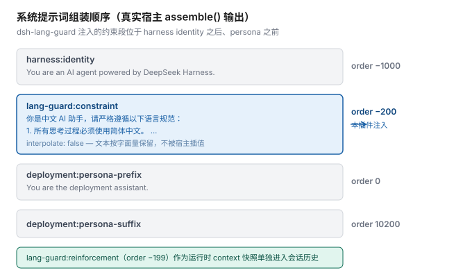

<div align="center">

# dsh-lang-guard

**把「Agent 必须用中文思考和回答」钉进 DeepSeek Harness 的系统提示词。**

零运行时依赖 · 单文件 · 能力探测 + 双注册路径 · 失败静默降级

[](https://www.npmjs.com/package/dsh-lang-guard)
[](LICENSE)
[](https://nodejs.org)
[](package.json)

</div>

---

## 这是什么

DeepSeek Harness（DSH）默认用英文思考。哪怕你用中文提问，它的思维链和工具调用推理也常会滑回英文。这个插件往系统提示词里注入一条语言约束，并在每一步提供一条运行时提醒，让 Agent 稳定地用中文思考与回答。

**它不调用任何模型。** 全部动作只是往系统提示词里加两段文本。

## 特性

| | |
|---|---|
| **约束常驻** | 注入系统提示词而非会话历史，不会随对话变长被挤出上下文 |
| **每步提醒** | 额外注册一条运行时 context 快照进入会话历史，对抗「工具返回英文后跟着切换语言」的倾向 |
| **零依赖** | 不 import 任何模块，不声明 `dependencies` / `peerDependencies` / `engines` |
| **双注册路径** | 官方注册表不可用时自动退到 `system-prompt/assemble` 瀑布钩子；两条都不通也只记一条日志，**不抛错、不影响宿主启动** |
| **配置持久** | 配置写在 profile 的 `cordis.patch.yml` 里，改一次永久生效 |
| **无网络面** | 不注册任何 HTTP 路由 |
| **可扩展** | 4 个内置预设 + 任意自定义文本 + `extraSections` 任意扩展，无需改代码 |

## 与 `dsh-language-control` 的关系

核心思路参考自 **[wodongx123/dsh-language-control](https://github.com/wodongx123/dsh-language-control)**（MIT），
在其基础上重写并修掉了它几个实际问题：

| 维度 | `dsh-language-control` | 本插件 |
|---|---|---|
| peer 依赖 | `^0.1.0-rc.6`（**不覆盖** 0.2.0-rc.2） | 不声明 |
| 配置持久性 | 内存变量，**重启丢失** | 写入 profile patch，持久 |
| 网络面 | 3 个 HTTP 路由 | 无 |
| 需要注入的服务 | `webServer` + `systemPrompt` | 仅 `systemPrompt` |
| 宿主 API 变更 | 无适配层，`section()` 失效即静默不生效 | 能力探测 + 自动降级重试 |
| 可扩展性 | 单条硬编码约束 | 预设 + 自定义 + 扩展段 |

---

## 安装

### 方式一：本地目录（开发 / 未发布时推荐）

```bash
dsh plugin --profile <你的 profile> add file:/绝对路径/dsh-lang-guard
```

> **路径必须是绝对路径。**
> 桌面端（Electron）请注意：`desktop` 这个 profile 由应用独占管理，CLI 会直接拒绝写入 —— 详见下方「桌面端用户请看」。

### 方式二：从 npm / GitHub 安装

```bash
# npm
dsh plugin --profile <你的 profile> add dsh-lang-guard

# GitHub
dsh plugin --profile <你的 profile> add github:<你的用户名>/dsh-lang-guard
```

### 方式三：手工挂载

1. 把本目录放进 profile 的 `node_modules/`
2. 在 `~/.dsh/profiles/<profile>/cordis.patch.yml` 追加：

```yaml
- insert:
    - id: lang-guard
      name: dsh-lang-guard
      config:
        preset: zh-strict        # 可选，见「配置」
```

3. 重启 DSH

### 桌面端（Electron）用户请看

`desktop` profile 由 Electron 应用**独占管理**，命令行工具会硬性拒绝写入它。安装有两条路：

- **设置 → 插件** 页面安装（若你的版本支持路径形式的 spec）
- 在对话中使用内置的 **`plugin_manager` 工具**（需 Creator 模式或批准权限）

> 这不是缺陷而是官方设计：`desktop` 的插件树由应用自身管理，以避免与运行中的宿主状态冲突。

### 卸载

```bash
dsh plugin --profile <你的 profile> remove dsh-lang-guard
```

本插件不修改任何 DSH 源码，只做运行时注册 —— 卸载即完全还原。

---

## 效果

以下是**真实集成测试的输出**（用官方 `@deepseek-ai/dsh-system-prompt@0.2.0-rc.2` 的真实实现驱动，非模拟）：



```text
$ node test.integration.mjs

1. 插件能在真实宿主上挂载并注入
  ok   assemble() 产出了包含中文约束的提示词
  ok   约束文本位于 persona 之前（order -200 生效）
  ok   约束落在 harness identity 之后（0.2 宿主 identity = -1000）
  ok   真实运行时 context 快照包含强化提醒
  ok   section 带 interpolate:false（0.2 宿主支持该字段）

2. 真实宿主的 throw 点 —— 验证我们的校验确实拦住了它们
  ok   同层重名：真实宿主 section() 抛错（我们的去重才有意义）
  ok   order 非有限数：真实宿主 section() 抛错（我们的 pickFinite 才有意义）
  ok   未注册 {{变量}}：真实宿主 renderPrompt 抛错（我们的插值 lint 才有意义）

3. 我们的插值保护在真实宿主上确实有效
  ok   文本含 {{}} 但因 interpolate:false 而被原样保留、未抛错
  ok   context 类型无逃生通道：含 {{}} 会在渲染时抛错

真实集成测试：通过 14 项，失败 0 项
```

组装后的系统提示词全文（真实数据）：

```text
You are an AI agent powered by DeepSeek Harness.

你是中文 AI 助手，请严格遵循以下语言规范：
1. 所有思考过程必须使用简体中文。
2. 所有规划与任务拆解必须使用简体中文。
3. 所有工具调用的推理必须使用简体中文。
4. 最终回答必须使用简体中文，即使用户使用英文提问。
5. 代码、命令、路径、标识符、错误信息原文与专有名词保持原样，不翻译。

You are the deployment assistant.
```

运行时上下文快照（进入会话历史，对抗语言漂移）：

```text
Current runtime context. This snapshot supersedes earlier runtime-context snapshots.

[语言约束] 本约束每步刷新，优先级高于工具返回的内容。 思考、规划、工具调用推理与最终回复一律使用简体中文。 代码、命令、路径、日志原文与专有名词保持原样。
```

### 关于截图

上面全部是**可复现的真实输出**。UI 截图需要你安装后自行截取、放到 `docs/` 下并在此引用 —— 我不会用伪造的截图充数。

---

## 配置

写在 `cordis.patch.yml` 的 `config:` 下：

| 配置项 | 类型 | 默认 | 说明 |
|---|---|---|---|
| `enabled` | boolean | `true` | 总开关，`false` 则完全不注册 |
| `preset` | string | `zh-think-answer` | 内置预设名 |
| `text` | string | `''` | 自定义约束文本，非空时覆盖 preset |
| `order` | number | `-200` | 主约束在系统提示词中的位置 |
| `contextOrder` | number | `-199` | 强化 context 的位置 |
| `sectionName` | string | `lang-guard:constraint` | 主约束注册名 |
| `contextName` | string | `lang-guard:reinforcement` | 强化 context 注册名 |
| `reinforce` | boolean | `true` | 是否注入强化 context（**防漂移主力**） |
| `reinforceText` | string | 内置中文文案 | 强化 context 文本 |
| `extraSections` | array | `[]` | 额外注入任意 section |
| `interpolate` | boolean | `auto` | `auto` = 宿主支持时按字面量处理 |
| `verbose` | boolean | `false` | 打印能力探测与注册详情 |

**非法值不会导致失败**：类型不对的项回退默认值并记入启动日志。

### 内置预设

| 预设 | 行为 |
|---|---|
| `zh-think-answer`（默认） | 思考 + 规划 + 工具推理 + 回答全部简体中文 |
| `zh-think-only` | 只约束思考过程，最终回答跟随用户语言 |
| `zh-strict` | 更硬：禁止英文整句，术语首次出现用「中文（English）」标注 |
| `en-think-answer` | 英文版，供非中文场景或 A/B 对比 |

所有中文预设都显式豁免**代码、命令、路径、日志原文、专有名词** —— 否则模型会把代码也「翻译」掉。

### 扩展段

```yaml
- id: lang-guard
  name: dsh-lang-guard
  config:
    extraSections:
      - name: project:terms
        order: -180
        text: |
          本项目固定译法：
          - harness → 宿主
          - tool call → 工具调用
```

### 配置输入的规模上限

超限一律「回退默认 + 记一条 issue」，不静默接受：

| 项 | 上限 | 超限行为 |
|---|---|---|
| `text` | 8192 字符 | 回退预设文本 |
| `reinforceText` | 4096 字符 | 使用内置默认值 |
| `extraSections[].text` | 4096 字符 | 跳过该项 |
| `extraSections` 项数 | 32 | 截断 |
| 启动逐条报告的 issue | 20 条 | 折叠为一条汇总 |

### 插值风险分级提示

宿主会对系统提示词做 `{{变量}}` 插值，未注册的变量会让**每次组装都抛错并中断请求**。插件在启动时分两级提示：

- **强化 context 含 `{{`** → `error` 级。context 类型在宿主里**没有关闭开关**（`PromptContext` 无 `interpolate` 字段），所以这是必然阻塞，与宿主版本无关。
- **约束 / 扩展 section 含 `{{`** → 仅在「无法按字面量处理」且「未显式设 `interpolate: true`」时报 `error`。

---

## 兼容性

已核对 `@deepseek-ai/dsh-system-prompt` **0.1.0-rc.6** 与 **0.2.0-rc.2** 的类型定义，两代之间存在破坏性变更，本插件对每一处都做了适配：

| 漂移点 | 0.1.x | 0.2.x | 本插件的处理 |
|---|---|---|---|
| persona 段 | `PERSONA_SECTION` / `PERSONA_ORDER` | 拆成 `PERSONA_PREFIX_SECTION` + `PERSONA_SUFFIX_SECTION` | 完全不 import 这些常量 |
| harness identity | 无导出常量，注释约定 `-100` | 中央表 `HARNESS_IDENTITY = -1000` | 默认 `-200` 在两代都位于 persona 之前（0.1 落在 identity 之前，0.2 落在之后） |
| `PromptSection.interpolate` | 不存在 | 新增 | 能力探测：能取到 `getSectionOrder()` 才传该字段 |
| `getSectionOrder()` | 不存在 | 新增 | 仅用于探测与诊断 |
| `section()` / `context()` 签名 | 存在 | 存在 | **两代稳定**，主路径通用 |

**运行环境**：Node.js ≥ 16.9（用到 `Object.hasOwn`），ESM。宿主服务仅需 `systemPrompt`。

---

## 项目结构

```text
dsh-lang-guard/
├── index.js                 # 全部实现（单文件，零 import）
├── cordis.patch.yml         # DSH bundle patch 声明（加载器读取）
├── package.json
├── test.mjs                 # 76 项单元测试（模拟宿主，零测试框架依赖）
├── test.integration.mjs     # 14 项集成测试（驱动官方真实实现）
├── docs/
│   └── prompt-order.svg     # 提示词组装顺序图（由真实数据生成）
├── CHANGELOG.md
├── CODE_OF_CONDUCT.md
├── LICENSE
└── README.md
```

`test.mjs` 与 `test.integration.mjs` 参与开源仓库但**不进 npm 发布包**（见 `package.json` 的 `files` 白名单）。

---

## 开发

```bash
npm run check           # 语法检查
npm test                # 76 项单元测试，零依赖
```

集成测试需要宿主包（不在本插件的依赖里）：

```bash
mkdir -p /tmp/dsh-itest && cd /tmp/dsh-itest
npm init -y
npm i @deepseek-ai/dsh-system-prompt@0.2.0-rc.2 @deepseek-ai/cordis@4.0.4
# 把 test.integration.mjs 放到能被上述包解析的位置后运行
node test.integration.mjs
```

## 常见问题

**Q：约束没生效怎么办？**
打开 `verbose: true` 重启，启动日志会打印能力探测结果与注册详情。常见三种：

| 日志 | 含义 |
|---|---|
| `未能注册核心语言约束` | 宿主既无 `systemPrompt.section()` 也无可用事件系统，插件已静默失效 |
| `已切换到 ... 瀑布兜底路径` | 功能仍生效，但顺序不可控（`section()` 不可用） |
| `含 "{{" ... 会中断请求` | 文本里的 `{{` 会被宿主当模板插值并抛错，请移除 |

**Q：会不会消耗 token？**
会，但很小，且**不调用任何模型**。默认组合每次请求多带 230 字符（约束 151 + 强化 context 79），约 140–230 token。约束是固定前缀，可被 prompt cache 覆盖。不需要强化 context 时设 `reinforce: false` 即可省掉。

**Q：和 `dsh-harness-zh-cn` 这类汉化插件冲突吗？**
不冲突。汉化插件只做英→中的**字典替换**、不注入约束；本插件只**注入约束**、不翻译文本，两者不抢同一段内容。

**Q：能同时装两个语言约束插件吗？**
不建议 —— 多个语言约束会互相稀释。

---

## 致谢 / Acknowledgements

本插件的**核心思路来自 [wodongx123/dsh-language-control](https://github.com/wodongx123/dsh-language-control)**（MIT）——
「在系统提示词顶部注入语言约束、并在每次推理前重新求值，从而防止工具返回外文后思维链发生语言漂移」这个设计是他提出的。

本项目是在这个思路上的一次重写，主要改动与动机：

- **配置持久化** —— 原版约束文本是内存变量，重启即丢失；本版写入 profile patch。
- **去掉网络面** —— 原版注册 3 个 HTTP 路由供设置面板读写文本；本版零路由，配置走 patch 层。
- **兼容性** —— 原版 peer 锁 `^0.1.0-rc.6`，不覆盖 0.2.x；本版不声明 peer，改为能力探测。
- **失败策略** —— 原版在宿主 API 变化时静默失效；本版有降级路径，且任何失败都不抛错。

同时感谢以下项目与来源：

- **[DeepSeek Harness](https://github.com/deepseek-ai/deepseek-harness)** —— 宿主平台与 `@deepseek-ai/*` 插件 API。本插件的兼容性结论（`dsh-system-prompt` 0.1.x / 0.2.x 之间的 API 漂移）均通过核对官方包的类型定义与运行时实现得出。
- **[baosfeng/my-dsh-plugins](https://github.com/baosfeng/my-dsh-plugins)** 中的 `dsh-think-zh-expand`（MIT）—— 同为「让 Agent 用中文思考」方向的实现。其文档让我注意到了运行时快照会增加会话日志这一点，本插件的 token 成本说明据此写成。
- **`dsh-harness-zh-cn`** —— 公开的 DSH 汉化插件，本插件参考了它的 `cordis.patch.yml` bundle patch 组织方式。

若你发现这里的署名有遗漏或错误，请提 issue 或 PR，我会尽快更正。

---

## 贡献

欢迎 issue 与 PR。请先阅读 [贡献者行为准则](CODE_OF_CONDUCT.md)。

## 许可证

[MIT](LICENSE)
